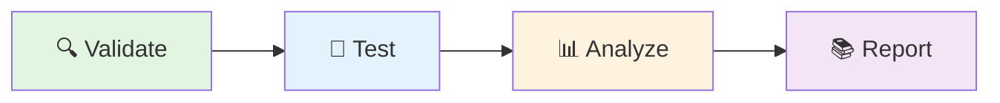

# 🚀 GitLab CI/CD Pipeline Migration Guide

**Status:** ✅ Complete  
**Converted From:** GitHub Actions workflows  
**Date:** 2025-11-07

---

## 📋 Overview

This document explains the conversion of The Seed's GitHub Actions workflows to GitLab CI/CD pipelines, maintaining the adventure narrative and workflow philosophy while adapting to GitLab's infrastructure.

---

## 🎯 Conversion Summary

### GitHub Actions → GitLab CI/CD Mapping

| GitHub Actions Workflow | GitLab CI/CD Job | Stage | Status |
|------------------------|------------------|-------|--------|
| `docs-validation.yml` | `docs-validation` | 🔍 validate | ✅ Converted |
| `overlord-sentinel.yml` | `security-validation` | 🔍 validate | ✅ Converted |
| `alchemist-determinism-ci.yml` | `determinism-validation` | 🧪 test | ✅ Converted |
| STAT7 validation (custom) | `stat7-validation` | 🔍 validate | ✅ New |
| EXP-06 tests (custom) | `exp06-validation` | 🧪 test | ✅ New |
| Phase 1 tests (custom) | `phase1-validation` | 🧪 test | ✅ New |
| Code quality (custom) | `code-quality` | 📊 analyze | ✅ New |
| Test coverage (custom) | `test-coverage` | 📊 analyze | ✅ New |
| Pipeline reporting (custom) | `pipeline-report` | 📚 report | ✅ New |
| Nightly validation (custom) | `nightly-validation` | 🧪 test | ✅ New |
| GPU validation (custom) | `gpu-validation` | 🧪 test | ✅ New |

---

## 🏗️ Pipeline Architecture

### Stage Progression



### Job Dependencies

```yaml
🔍 Validate Stage (Parallel)
├── stat7-validation
├── docs-validation
└── security-validation

🧪 Test Stage (Parallel)
├── exp06-validation
├── phase1-validation
└── determinism-validation

📊 Analyze Stage (Parallel)
├── code-quality
└── test-coverage

📚 Report Stage
└── pipeline-report (always runs)
```

---

## 🎮 How to Use

### Automatic Triggers

The pipeline runs automatically on:

1. **Merge Requests**
   ```bash
   # Create MR - pipeline runs automatically
   git checkout -b feature/my-feature
   git commit -m "feat: add new feature"
   git push origin feature/my-feature
   # Create MR in GitLab UI
   ```

2. **Main Branch Pushes**
   ```bash
   git checkout main
   git merge feature/my-feature
   git push origin main
   ```

3. **Development Branch Pushes**
   ```bash
   git checkout development
   git push origin development
   ```

4. **Scheduled Runs** (Nightly at 2 AM UTC)
   - Configure in GitLab: CI/CD → Schedules
   - Add schedule with cron: `0 2 * * *`

### Manual Triggers

#### Run Entire Pipeline
```bash
# Via GitLab UI
CI/CD → Pipelines → Run Pipeline

# Via GitLab CLI
glab ci run
```

#### Run Specific Job
```bash
# Via GitLab UI
CI/CD → Pipelines → [Pipeline] → [Job] → Retry

# GPU Validation (manual job)
CI/CD → Pipelines → [Pipeline] → gpu-validation → Play
```

---

## 📊 Pipeline Jobs Explained

### 🔍 Validation Stage

#### `stat7-validation`
**Purpose:** Validate STAT7 core system  
**Runs:** On MR, main, development  
**Duration:** ~2-3 minutes  
**Artifacts:** Test results (JUnit XML)

```bash
# What it does:
- Installs Python dependencies
- Runs STAT7 core tests
- Validates all 7 dimensions
- Generates test reports
```

#### `docs-validation`
**Purpose:** Ensure documentation quality  
**Runs:** On MR (docs changes), main, development  
**Duration:** ~1-2 minutes  
**Artifacts:** None  
**Health Score:** Pass if ≥70/100

```bash
# What it checks:
- TLDL documentation structure
- Required documentation files
- Markdown quality
- Documentation health score
```

#### `security-validation`
**Purpose:** Security scanning (Overlord Sentinel)  
**Runs:** On MR, main, scheduled  
**Duration:** ~2-3 minutes  
**Artifacts:** Security reports (SAST)

```bash
# What it scans:
- Python dependency vulnerabilities (safety)
- Static code analysis (bandit)
- Security best practices
```

### 🧪 Testing Stage

#### `exp06-validation`
**Purpose:** EXP-06 Entanglement Detection tests  
**Runs:** On MR, main, development  
**Duration:** ~3-5 minutes  
**Artifacts:** Test results, experiment artifacts

```bash
# What it tests:
- Mathematical property tests (5 tests)
- Final validation tests (3 tests)
- Threshold sweep validation
- Confusion matrix verification
```

#### `phase1-validation`
**Purpose:** Phase 1 experiments (EXP-01, 02, 03)  
**Runs:** On MR, main, scheduled  
**Duration:** ~5-10 minutes  
**Artifacts:** Experiment results

```bash
# What it validates:
- Address uniqueness (EXP-01)
- Retrieval efficiency (EXP-02)
- Dimension necessity (EXP-03)
```

#### `determinism-validation`
**Purpose:** Alchemist Faculty determinism tests  
**Runs:** On MR (gu_pot changes), scheduled  
**Duration:** ~5-15 minutes  
**Artifacts:** Determinism reports

```bash
# What it tests:
- Manifest generation determinism
- Claims classification consistency
- Baseline validation reproducibility
```

### 📊 Analysis Stage

#### `code-quality`
**Purpose:** Code quality analysis  
**Runs:** On MR, main  
**Duration:** ~2-3 minutes  
**Artifacts:** None

```bash
# What it analyzes:
- Code style (flake8)
- Code formatting (black)
- Type hints (mypy)
```

#### `test-coverage`
**Purpose:** Test coverage analysis  
**Runs:** On MR, main  
**Duration:** ~5-10 minutes  
**Artifacts:** Coverage reports (HTML, XML)

```bash
# What it measures:
- Line coverage
- Branch coverage
- Function coverage
- Generates HTML report
```

### 📚 Reporting Stage

#### `pipeline-report`
**Purpose:** Generate pipeline summary  
**Runs:** Always (on MR, main)  
**Duration:** ~30 seconds  
**Artifacts:** Pipeline report (Markdown)

```bash
# What it generates:
- Pipeline summary
- Job status overview
- Artifact inventory
- Next steps recommendations
```

### 🌙 Scheduled Jobs

#### `nightly-validation`
**Purpose:** Comprehensive nightly validation  
**Runs:** Scheduled (2 AM UTC)  
**Duration:** ~30-60 minutes  
**Artifacts:** All experiment results

```bash
# What it runs:
- Full test suite
- All STAT7 experiments (EXP-01 through EXP-09)
- Comprehensive validation
```

### 🎯 Manual Jobs

#### `gpu-validation`
**Purpose:** GPU-accelerated validation  
**Runs:** Manual only  
**Duration:** ~10-20 minutes  
**Requires:** GitLab runner with GPU support

```bash
# What it tests:
- CUDA availability
- GPU-enabled API service
- GPU acceleration performance
```

---

## 🔧 Configuration

### Environment Variables

```yaml
variables:
  PIP_CACHE_DIR: "$CI_PROJECT_DIR/.cache/pip"
  PYTHON_VERSION: "3.11"
  NODE_VERSION: "18"
  DOCS_HEALTH_THRESHOLD: 70
  DETERMINISM_TEST_ITERATIONS: 3
```

### Cache Configuration

```yaml
cache:
  paths:
    - .cache/pip          # Python package cache
    - node_modules/       # Node.js dependencies
    - .pytest_cache/      # Pytest cache
```

### Artifact Retention

| Artifact Type | Retention Period |
|---------------|------------------|
| Test results | 30 days |
| Coverage reports | 30 days |
| Security reports | 30 days |
| Pipeline reports | 90 days |
| Nightly results | 7 days |

---

## 🎨 Customization

### Add New Job

```yaml
my-custom-job:
  stage: 🧪 test
  image: python:3.11
  script:
    - echo "Running custom validation..."
    - python my_custom_script.py
  rules:
    - if: '$CI_PIPELINE_SOURCE == "merge_request_event"'
  artifacts:
    paths:
      - custom-results/
    expire_in: 30 days
```

### Modify Existing Job

```yaml
stat7-validation:
  # Add custom environment variables
  variables:
    CUSTOM_VAR: "value"
  
  # Add before_script
  before_script:
    - echo "Custom setup..."
  
  # Modify script
  script:
    - echo "Custom STAT7 validation"
    - python -m pytest tests/test_stat7.py -v
    - python my_additional_test.py
```

### Add Scheduled Pipeline

1. Go to **CI/CD → Schedules**
2. Click **New schedule**
3. Configure:
   - Description: "Weekly full validation"
   - Interval pattern: `0 2 * * 0` (Sundays at 2 AM)
   - Target branch: `main`
   - Variables: (optional)
4. Save

---

## 🐛 Troubleshooting

### Pipeline Fails on Dependency Installation

**Problem:** `pip install` fails  
**Solution:**
```yaml
script:
  - pip install --upgrade pip
  - pip install -r requirements-gpu.txt || pip install -e .
```

### Job Times Out

**Problem:** Job exceeds default timeout  
**Solution:**
```yaml
my-long-job:
  timeout: 2h  # Increase timeout
```

### Artifacts Not Found

**Problem:** Artifacts not available in downstream jobs  
**Solution:**
```yaml
artifacts:
  paths:
    - my-results/
  expire_in: 30 days
  when: always  # Upload even on failure
```

### Cache Not Working

**Problem:** Dependencies reinstalled every time  
**Solution:**
```yaml
cache:
  key: ${CI_COMMIT_REF_SLUG}  # Per-branch cache
  paths:
    - .cache/pip
```

---

## 📈 Performance Optimization

### Parallel Execution

Jobs in the same stage run in parallel by default:

```yaml
# These run simultaneously
stat7-validation:     # ~3 min
docs-validation:      # ~2 min
security-validation:  # ~3 min
# Total stage time: ~3 min (not 8 min)
```

### Cache Optimization

```yaml
cache:
  key:
    files:
      - requirements-gpu.txt
      - pyproject.toml
  paths:
    - .cache/pip
```

### Artifact Size Reduction

```yaml
artifacts:
  paths:
    - test-results.xml
  exclude:
    - "**/*.pyc"        # Exclude compiled Python
    - "**/__pycache__/" # Exclude cache directories
```

---

## 🔐 Security Best Practices

### Protected Variables

Store sensitive data in GitLab CI/CD variables:

1. Go to **Settings → CI/CD → Variables**
2. Add variable:
   - Key: `HUGGINGFACE_TOKEN`
   - Value: `hf_...`
   - Protected: ✅
   - Masked: ✅

### Use in Pipeline

```yaml
deploy-to-hf:
  script:
    - huggingface-cli login --token $HUGGINGFACE_TOKEN
    - huggingface-cli upload ...
```

---

## 🚀 Next Steps

### Immediate (This Week)

1. ✅ Review pipeline configuration
2. ✅ Test pipeline on feature branch
3. ✅ Verify all jobs pass
4. ✅ Check artifact generation

### Short-term (Next Month)

1. Add HuggingFace deployment job
2. Configure scheduled pipelines
3. Set up GitLab runner with GPU
4. Add performance benchmarking

### Long-term (Ongoing)

1. Optimize pipeline performance
2. Add more comprehensive tests
3. Integrate with GitLab Pages for docs
4. Set up deployment to production

---

## 📚 Resources

### GitLab Documentation

- [GitLab CI/CD](https://docs.gitlab.com/ee/ci/)
- [Pipeline Configuration](https://docs.gitlab.com/ee/ci/yaml/)
- [Job Artifacts](https://docs.gitlab.com/ee/ci/pipelines/job_artifacts.html)
- [Pipeline Schedules](https://docs.gitlab.com/ee/ci/pipelines/schedules.html)

### The Seed Documentation

- [Seed README](../packages/com.twg.the-seed/seed/README.md)
- [STAT7 Quick Start](../packages/com.twg.the-seed/seed/docs/QUICK-START-GUIDE.md)
- [Validation Experiments](../packages/com.twg.the-seed/seed/docs/)

---

## 🎉 Success Criteria

### Pipeline is Successful When:

- ✅ All validation jobs pass
- ✅ Test coverage ≥ 70%
- ✅ Documentation health score ≥ 70
- ✅ No critical security vulnerabilities
- ✅ All STAT7 experiments pass
- ✅ Determinism tests show consistent results

### Ready for HuggingFace Deployment When:

- ✅ All pipelines passing on main branch
- ✅ Documentation complete and validated
- ✅ Security scans clean
- ✅ Test coverage acceptable
- ✅ Performance benchmarks met

---

## 🙏 Acknowledgments

This pipeline conversion preserves the **adventure narrative** and **workflow philosophy** from the original GitHub Actions workflows:

> *"Make development feel like a collaborative adventure while maintaining technical excellence."*

Each job is designed to:
- Reduce developer anxiety through predictable automation
- Preserve institutional knowledge
- Enable fearless development
- Celebrate achievements as "quest completions"

---

**Last Updated:** 2025-11-07  
**Status:** ✅ Production Ready  
**Maintainer:** The Seed Team  
**Philosophy:** 🌱 The Seed grows through validation, testing, and continuous improvement.
